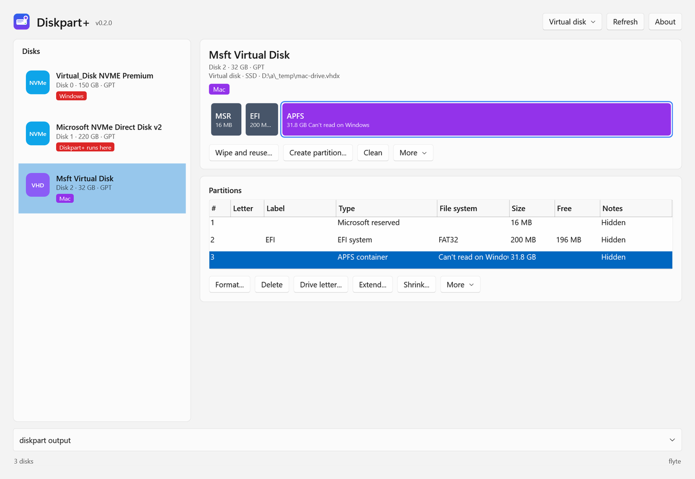

<h1 align="center">
  <br>
  Diskpart+
</h1>

<p align="center">
  A clean, modern GUI for Windows' built-in <code>diskpart</code>.<br>
  All the power of the command line, without guessing which disk is which.
</p>

<p align="center">
  <a href="https://github.com/flyteongithub/diskpart-plus/releases/latest"></a>
  <a href="https://github.com/flyteongithub/diskpart-plus/actions/workflows/ci.yml"></a>
  
  <a href="LICENSE"></a>
</p>

<p align="center">
  <picture>
    <source media="(prefers-color-scheme: dark)" srcset="docs/screenshot-dark.png">
    
  </picture>
</p>

## Download and run

1. Grab the latest `.exe` from **[Releases](https://github.com/flyteongithub/diskpart-plus/releases/latest)**. Pick `win-x64` for almost any PC, or `win-arm64` for Snapdragon and other ARM laptops.
2. Double-click it. It's a single file with nothing to install. Windows asks for admin rights because diskpart needs them.
3. The app isn't code-signed yet, so Windows may say **"Windows protected your PC"**. Click **More info**, then **Run anyway**.

New to it? Click **Create virtual disk...** first and practise on that. It behaves like a real disk and you can wipe it as often as you like.

## Why

Diskpart+ puts a proper interface on top of diskpart.

## What it does

**See what you've got**
- Every disk, partition and volume with its size, file system, label and drive letter
- Real names for Mac (APFS, HFS+), Linux and Windows partition types instead of "Unknown"
- Drive type at a glance (NVMe, SSD, HDD, USB, virtual) and which disk Windows is running from

**Partitions and drive letters**
- Create, delete, format, extend and shrink partitions
- Assign, change and remove drive letters
- Delete protected partitions (EFI, recovery, OEM) that Disk Management greys out

**Whole disks**
- **Wipe and reuse** in one step: clear a Mac or Linux drive and get back one clean exFAT or NTFS partition
- `clean` and `clean all`
- Convert between GPT and MBR
- Clear a stuck read-only flag on "write protected" drives
- Bring disks online or take them offline
- Fix duplicate disk IDs, which often happen after cloning a drive
- Set partition type IDs and GPT attributes

**Virtual disks**
- Create, attach and detach VHD and VHDX files

**The app**
- Fluent design with light and dark themes that follow Windows
- Live diskpart output and the exact script for every change

## Safety without the hand-holding

- **One look before anything is erased.** Format, delete and clean show the steps and the exact script, with a button that says what it does ("Erase disk 2"). Everything else just runs.
- **It won't touch your Windows disk.** Destructive changes to the disk Windows runs or boots from, the page file disk or the disk Diskpart+ runs from are blocked.
- **It checks it's still the same drive.** Disk numbers can change when drives come and go, so Diskpart+ re-reads your disks right before running.
- **Mistakes get caught early.** FAT32 over 32 GB, labels that are too long, letters already taken and so on are flagged in one line before diskpart starts.

## What it can't do

Diskpart+ can tell you a partition is APFS or HFS+ and it can wipe it, but it can't open it or copy files off it. Windows has no driver for Mac file systems, so diskpart only ever sees them as raw partitions. If there's anything on the drive you need, back it up on a Mac first.

## How it's tested

- **Engine:** over 120 unit tests cover the safety rules, the planner and every diskpart command it can write.
- **Real diskpart:** on every push, CI creates throwaway virtual disks on Windows and runs every kind of operation through real diskpart, then reads the disks back to check the result.
- **UI:** CI launches the built app, renders its windows in light and dark mode and fails if anything breaks.

What hasn't happened yet is testing on lots of real hardware. If something looks off on your machine, please [open an issue](https://github.com/flyteongithub/diskpart-plus/issues).

## Roadmap

- [x] Engine: models, safety rules, planner and script builder
- [x] Windows layer: reads disks through the storage API and runs diskpart
- [x] WPF app
- [x] First preview release
- [ ] Code signing, so the SmartScreen warning goes away
- [ ] Windows install layout template (EFI, MSR, Windows and recovery partitions)
- [ ] Show the volume names inside APFS and HFS+ containers
- [ ] Translations
- [ ] winget package

## Requirements

- Windows 10 (22H2) or Windows 11, x64 or ARM64
- Administrator rights

## Building from source

You'll need the [.NET 10 SDK](https://dotnet.microsoft.com/download/dotnet/10.0).

```
git clone https://github.com/flyteongithub/diskpart-plus.git
cd diskpart-plus
dotnet test
dotnet run --project src/DiskpartPlus.App
```

The engine tests run on any OS. The app and the real diskpart tests need Windows. The real diskpart tests only run as administrator with `DISKPARTPLUS_INTEGRATION=1` set, and they only ever touch throwaway VHDX files in your temp folder.

To build the single-file .exe yourself:

```
dotnet publish src/DiskpartPlus.App -c Release -r win-x64 --self-contained -p:PublishSingleFile=true -p:IncludeNativeLibrariesForSelfExtract=true
```

## Project layout

```
src/
  DiskpartPlus.Core/            the engine: models, safety rules, planner, script builder
  DiskpartPlus.Windows/         reads disks through the storage API and runs diskpart
  DiskpartPlus.App/             the WPF app
tests/
  DiskpartPlus.Core.Tests/      unit tests for the engine
  DiskpartPlus.Windows.Tests/   real diskpart tests on throwaway virtual disks
docs/
  ARCHITECTURE.md               how the pieces fit together
```

## Contributing

Issues and pull requests are welcome. Have a read of [CONTRIBUTING.md](CONTRIBUTING.md) first, especially the part about testing on virtual disks instead of real ones.

## Licence

[MIT](LICENSE) © flyteongithub

Diskpart+ is an independent project. It isn't affiliated with or endorsed by Microsoft. It changes partitions on real disks, so keep backups.
